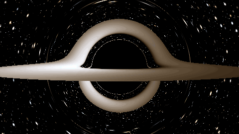
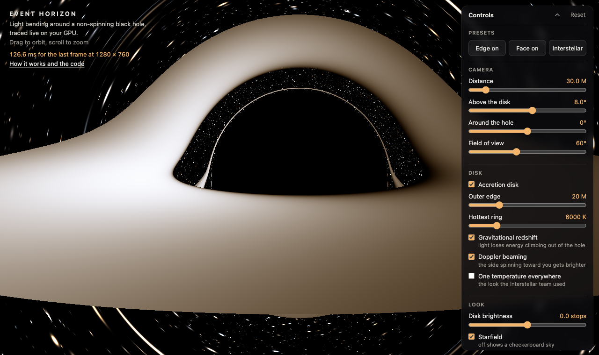
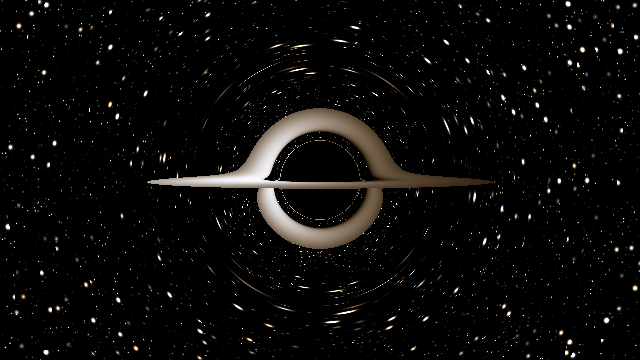
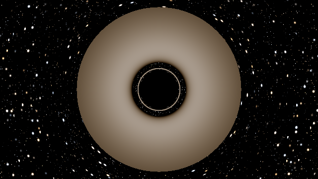
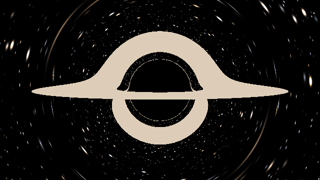
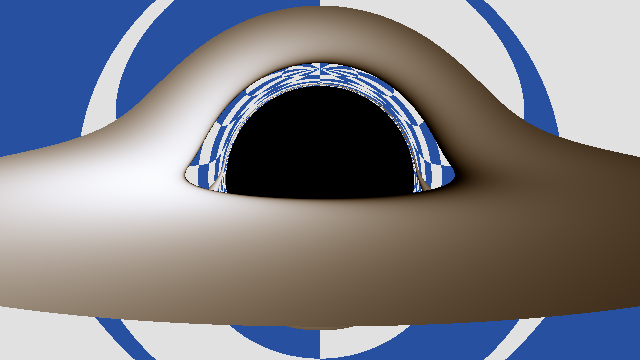

# Event Horizon

A real-time black hole renderer that runs in the browser. Light rays bend around a non-spinning black hole, so you see its black shadow, the stars lensed around it, and an accretion disk that's brighter on the side spinning toward you.

**Live demo: [joshuacortes195.github.io/event-horizon](https://joshuacortes195.github.io/event-horizon/)** (needs WebGL2, so any recent desktop or phone browser)



Every pixel is a light ray traced backward from the camera, step by step, through the curved space around the hole, so the shadow, the arcs and the smeared stars all come out of the ray math. I wrote the tracer twice: once in C++ as a slow, double precision reference that's tested against textbook values, and once as a WebGL2 fragment shader that has to match the C++ version to within a few pixels on hard edges.

## What you're looking at



- The black shadow is every ray that fell in. Rays aimed closer than 3 sqrt(3) M to the hole (about 5.2 times its mass in these units) don't get out. The shadow looks bigger than the event horizon because light that passes close gets pulled in too
- The arc over the top is the back of the disk. Its light gets bent up and over the hole on its way to you, so you see the far side of a flat disk standing up behind the shadow. The arc under the hole is the underside of the disk, bent the other way
- The thin bright ring is light that went most of the way around the hole before it got out, hugging the photon sphere at 3M
- One side of the disk is brighter than the other. The disk orbits very fast, fastest at its inner edge. Gas coming toward you looks brighter and bluer (Doppler beaming) and gas going away looks dimmer and redder. On top of that, all of it loses some energy climbing out of the hole's gravity (gravitational redshift)
- Stars near the shadow are smeared into arcs and some show up twice, once on each side of the hole

## Presets

| Edge on | Face on |
| --- | --- |
|  |  |
| **Interstellar** | **Checkerboard sky** |
|  |  |

The Interstellar preset copies what the film's visual effects team describes in their paper (James, von Tunzelmann, Franklin and Thorne 2015): the camera 74.1M away and 3.44 degrees above the disk, one 4500K temperature across the whole disk, and no Doppler or gravitational shifts at all, because they left those out of the film on purpose. Their black hole spins and mine doesn't, so the picture comes out different. The checkerboard sky is the debug view. Straight lines in the sky make the bending easy to see, and it's the sky the CPU vs GPU test uses.

The control panel has the camera (distance, angle above the disk, angle around the hole, field of view), the disk (on or off, outer edge, temperature, redshift, beaming, one temperature everywhere), disk brightness, stars or checkerboard, and quality (max steps per ray, resolution). The address bar follows the view, so a link opens the same picture. On a phone the panel is a sheet along the bottom, one finger orbits and two fingers pinch to zoom.

## How it works

1. In units where G = c = 1, a light ray around a Schwarzschild black hole obeys one equation in plain x, y, z: acceleration = -3M h^2 x / r^5, where h is the ray's angular momentum. I derived it from the metric in [my physics notes](docs/physics-notes.md). Each ray is stepped with RK4
2. The camera is a static observer at a fixed distance, and pixel directions are set in its own frame. That lets me test the shadow's size against the exact formula for that observer instead of eyeballing it
3. The disk is thin and flat, from the innermost stable orbit (6M) outward. A ray hits it when its y changes sign between steps. Its temperature follows the standard thin disk profile, and its color is a blackbody at the temperature you'd see after the redshift factor g, which comes from the disk's orbital speed and the ray's angular momentum
4. A ray that gets away looks up a procedural starfield (or the checkerboard) in the direction it ends up going
5. The shader is the same math in GLSL on one full screen quad. Raw WebGL2, no three.js
6. To make it fast, a ray that's heading out and has almost no bend left (under 1e-4 radians still to come) stops early, steps get bigger once the ray is far out compared to how close it passes the hole, and while you drag on a slow GPU the page drops the resolution and goes back to full quality once you stop

## Numbers

All measured, with the machine, browser and settings for each one in [results/README.md](results/README.md).

### Physics checks

From the C++ tracer's tests in `tests/` (26 test cases, 104 assertions):

| Check | Expected | Measured |
| --- | --- | --- |
| Rays just either side of b = 3 sqrt(3) M | inside falls in, outside escapes | both right at 1e-6 either side |
| Closest approach of an escaping ray | b = r0 / sqrt(1 - 2M / r0) | worst relative error 5.3e-6 |
| Light bending at b = 1000M | weak field series, 4.0118e-3 rad | relative error 2.7e-10 |
| Shadow edge at 6M, 10M and 30M | Synge's formula for a static observer | within 1e-5 relative |
| RK4 error when the step is halved | drops 16x | 16.0x |
| Approaching vs receding side, edge on | brighter with beaming on, equal with it off | 2.05x with it on, 1.000 off |

### CPU vs GPU

A Playwright test renders six views on both the C++ tracer and the shader and compares them channel by channel. At most 39 of 57,600 pixels differ by more than 16 out of 255, all on knife edges like the rim of the shadow or the edge of a checkerboard square.

### Frame time

The `?bench` page draws each view 30 times after 5 warmups and takes the median, waiting for the GPU after every frame. Default view, 4000 steps:

| Machine | 640 x 360 | 1280 x 720 | 1920 x 1080 |
| --- | --- | --- | --- |
| Intel Mac, Iris Plus 655 (integrated), Chrome 155 | 24.9 ms (40.2 fps) | 88.0 ms (11.4 fps) | 192.1 ms (5.2 fps) |
| PC, RTX 3060, Chromium 156 | 2.7 ms (370 fps) | 7.6 ms (132 fps) | 15.2 ms (65.8 fps) |
| iPhone 16, Apple GPU, Safari 26.6.1 | 11 ms (90.9 fps) | 34 ms (29.4 fps) | 73 ms (13.7 fps) |

The early exit and the adaptive step made the shader 1.70x to 2.03x faster on the RTX 3060 at 1080p (default view 25.8 ms to 15.2 ms), and in the five views I checked pixel by pixel, not one pixel changed whether it shows sky, disk or shadow. I set myself a goal of 60 fps at default quality on my Intel Mac, and it misses: 40 fps at 640 x 360 and less at bigger sizes. My iPhone 16 clears 60 at 640 x 360 (Safari only reports whole milliseconds, so its numbers are coarser). The live page shows the measured time of the last still frame in the corner, so you can see what your own GPU does.

## Limits

- The black hole doesn't spin (Schwarzschild, not Kerr), so the Interstellar preset is an approximation of the film, not a copy
- The disk is infinitely thin, with no thickness, turbulence or jets, and it's colored as one blackbody per pixel
- Light travel time across the disk is ignored
- On an integrated GPU a full resolution still frame at 1080p takes about 0.2 seconds, so the page leans on dropping the resolution while you drag

## Build and test

The C++ side needs CMake and a C++17 compiler. On Windows I build with MinGW-w64 GCC and add `-G "MinGW Makefiles"` to the first cmake line.

```bash
cmake -S . -B build -DCMAKE_BUILD_TYPE=Release
cmake --build build
ctest --test-dir build

# render the reference images in results/: width height r fov elevation disk_outer temp look
./build/render results/shadow.png
./build/render results/disk_edge_on_physical.png 640 360 50 80 2 20 6000 physical
```

The web side:

```bash
cd web
npm install
npx playwright install chromium   # once, for the browser tests
npm run dev                       # open the printed localhost link

# the cpu vs gpu pixel test and the control panel tests, needs the native build above first
npm test

# frame time benchmark: opens the ?bench page, wait for "done" and copy the table
npm run bench

# production build into web/dist, the same thing the GitHub Pages workflow deploys
npm run build
```

## Where things are

```
core/         C++ reference tracer: the ray equation, RK4, camera, disk, colors
tests/        C++ tests (doctest)
tools/        native CLIs that render the reference images
web/src/      the shader (blackhole.frag), the render loop, the panel and the benchmark
web/tests/    the CPU vs GPU pixel test and the panel tests (Playwright)
docs/         the plan, my physics notes and the README images
results/      reference images and every measured number with how it was measured
```

The plan and the decisions behind it are in [docs/plan.md](docs/plan.md).
