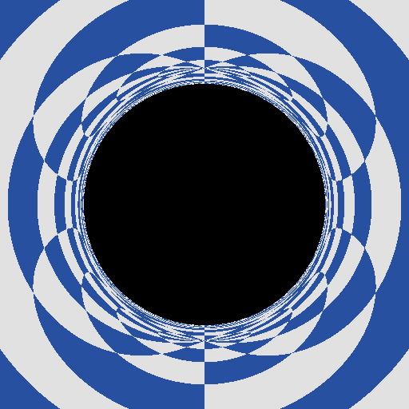
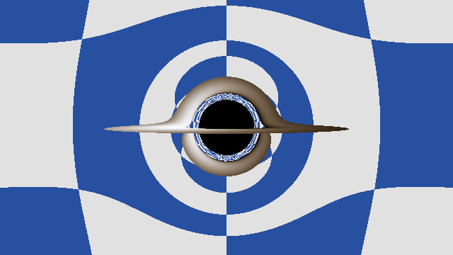
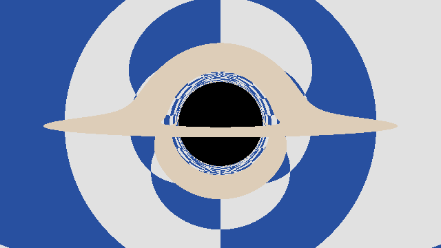

# Results

Every image and number here says how it was made. Nothing in this folder is an estimate.

Machine for everything below unless it says otherwise: Intel Core i5-8259U @ 2.30GHz (4 cores, 8 threads), 8 GB RAM, macOS 15.7.7, Apple clang 17.0.0, CMake Release build (`-O3 -DNDEBUG`).

## Phase 1: CPU tracer

### shadow.png

The black hole's shadow on the checkerboard debug sky, seen by a static observer.

| Setting | Value |
| --- | --- |
| Command | `./build/render results/shadow.png` (the defaults) |
| Size | 512 x 512 |
| Observer | static, at r = 15M, looking straight at the hole |
| Field of view | 60 degrees across the width |
| Integrator | RK4, step = 0.01 r, captured below r = 2M, escaped past r = 1000M heading out |
| Threads | 1 |
| Render time | 16.27 s (one run, timed inside the tool with `std::chrono::steady_clock`) |

I counted the black pixels in the saved PNG: 302 across the middle row and 302 down the middle column. The static observer formula sin(alpha) = (3 sqrt(3) M / r) sqrt(1 - 2M / r) gives alpha = 0.3284 rad at r = 15M, so the shadow should be 2 * tan(alpha) / tan(30 deg) * 256 = 302.1 px across. The test suite checks the same thing to the pixel on a smaller image.

### Accuracy of the tracer

From the test suite (`tests/test_tracer.cpp`, `tests/test_render.cpp`), all at step = 0.01 r unless it says otherwise.

| Check | Expected | Measured |
| --- | --- | --- |
| Capture vs escape around b = 3 sqrt(3) M | captured at b_crit (1 - 1e-6), escapes at b_crit (1 + 1e-6) | both right |
| Closest approach r0 for r0 = 3.5, 4, 6, 10, 50 | b = r0 / sqrt(1 - 2M / r0) | largest relative error 5.3e-6 (at r0 = 4). It comes from only checking r at step points, which can be off by up to about 1.25e-5 relative depending on where the steps land |
| Bending at b = 1000M | 4-term weak field series, 4.011823809e-3 rad | relative error 2.7e-10 |
| Bending at b = 300M | 4-term weak field series | relative error 2.2e-8 (about the size of the 5th order term the series leaves out) |
| Photon sphere, launched sideways at r = 3M, 360 steps per orbit | stays at r = 3M | off by 1.2e-6 after one orbit |
| Photon sphere instability | errors grow by e^(2 pi) = 535.5 per orbit | 537.5 from orbit 1 to orbit 2 |
| RK4 order | error drops 16x when the step is halved | 16.0 (1.155e-6 at 360 steps per orbit, 7.24e-8 at 720) |
| Shadow edge for a static observer at r = 6M, 10M, 30M | Synge's formula | within 1e-5 relative, both across and up |

The bending numbers and the photon sphere numbers come from small probe programs run once with the same tracer, and the tests check them with some margin.

## Phase 2: accretion disk on the CPU

Six reference images of a thin disk around the hole. All of them are 640 x 360 on the checkerboard sky, rendered one at a time on one thread with the same tracer settings as above. Render times are single runs, timed inside the tool.

The disk sits in the y = 0 plane from the ISCO (6M) out to 20M. 20M is my own pick so the disk fits on screen, not a value from a paper. A ray hits the disk when its y changes sign during a step and the crossing point (linear interpolation along that step) is between 6M and 20M. The disk is opaque, so the first hit is the color.

Colors: the gas at radius r has the thin disk temperature T(r), the light reaches the camera shifted by g, and a blackbody at T is seen as a blackbody at gT. I turn that into CIE XYZ and then sRGB. Exposure is set so the hottest ring with no shifts has brightness Y = 1, then each channel goes through 1 - exp(-c) so bright spots roll off instead of clipping, then the sRGB gamma curve.

The 6000K peak is picked so the disk looks white hot in visible light. A real disk around a stellar mass black hole is far hotter and glows mostly in X-rays, so the colors are a look, not a measurement.

| Image | Command (`./build/render ...`) | Camera | Disk | Time |
| --- | --- | --- | --- | --- |
| [disk_face_on_physical.png](disk_face_on_physical.png) | `results/disk_face_on_physical.png 640 360 50 80 90 20 6000 physical` | r = 50M, fov 80 deg, 90 deg above the disk (over the pole) | 6000K peak, redshift and beaming on | 9.81 s |
| [disk_face_on_flat.png](disk_face_on_flat.png) | `results/disk_face_on_flat.png 640 360 50 80 90 20 6000 flat` | same | 6000K peak, both off | 9.87 s |
| [disk_edge_on_physical.png](disk_edge_on_physical.png) | `results/disk_edge_on_physical.png 640 360 50 80 2 20 6000 physical` | r = 50M, fov 80 deg, 2 deg above the disk | 6000K peak, both on | 12.72 s |
| [disk_edge_on_flat.png](disk_edge_on_flat.png) | `results/disk_edge_on_flat.png 640 360 50 80 2 20 6000 flat` | same | 6000K peak, both off | 12.79 s |
| [disk_interstellar.png](disk_interstellar.png) | `results/disk_interstellar.png 640 360 74.1 40 3.44 20 4500 uniform` | r = 74.1M, fov 40 deg, 3.44 deg above the disk | one temperature (4500K) everywhere, no shifts | 14.00 s |
| [disk_interstellar_angle_physical.png](disk_interstellar_angle_physical.png) | `results/disk_interstellar_angle_physical.png 640 360 74.1 40 3.44 20 4500 physical` | same | 4500K peak, both on | 17.42 s |

The Interstellar camera and disk come from the film team's paper (James, von Tunzelmann, Franklin and Thorne 2015, arXiv:1502.03808): no Doppler or gravitational shifts, one 4500K temperature, camera at 74.1M and 3.44 degrees above the disk. Their hole spins (a/M = 0.6) and mine doesn't, so it's the same idea, not the same picture.

### How much brighter the approaching side is

Sum of R + G + B over the disk pixels in the left half of the image divided by the same sum for the right half. A pixel counts as disk if it differs from the same view rendered with no disk. Measured with `./build/beaming_ratio 640 360 50 80 2 20 6000` and `./build/beaming_ratio 640 360 74.1 40 3.44 20 4500` (`tools/beaming_ratio.cpp`). The numbers come out the same on every run, nothing in it is random.

| View | Shifts off | Redshift and beaming on |
| --- | --- | --- |
| Edge on (r = 50M, 2 deg, 6000K) | 1.000 | 2.054 |
| Interstellar angle (r = 74.1M, 3.44 deg, 4500K) | 1.000 | 2.896 |

On screen the gap is smaller than in the light itself. Take the edge on test view in `tests/test_render.cpp` (r = 30M, fov 1.2 rad, 0.1 rad above the disk, 6000K) and the two rays at screen x = -0.5 and +0.5, y = -0.05. Both hit the disk at r = 10.75M. The left one has g = 1.227, the right one g = 0.685, and their brightness Y relative to the unshifted hottest ring is 1.784 and 0.091, about 20 times apart. (g at that radius ranges from about 0.66 to 1.32 depending on where on the ring the ray lands.)

Two steps squeeze that 20x. For a grey of those brightnesses, the 1 - exp(-c) roll off takes it to 0.832 vs 0.087 (about 9.6x), and the sRGB gamma curve takes that to 0.922 vs 0.326 (about 2.8x). The test on that view measures 2.17 over all disk pixels and checks it stays within 5%.

### Accuracy of the disk hits

From `tests/test_disk.cpp`. Face on rays from far up the spin axis with the impact parameter of a known ring:

| Ring | b | Lands at |
| --- | --- | --- |
| 8.1667M (hottest) | 9.11432 | 8.1666219 (relative error 5.5e-6) |
| 10M | 10.95612 | 9.9999860 (1.4e-6) |
| 6M (ISCO) | 6.93215 | 5.9999634, so it falls just inside the hole in the disk. With a 10x smaller step it lands at 6.0000011 |

Because the 6M ray sits right on the edge, the RK4 step error decides which side it lands on, so the test checks the edge with b = 6.88 (falls through) and b = 6.98 (lands between 6M and 6.1M) instead. The ring checks use a relative tolerance of 2e-5.

### What the disk tests catch

After review I broke the code on purpose in a scratch copy and ran the tests each time. Caught: a wrong orbital speed (Omega = r^-1 or r^-1.25), (1 - Omega L) in place of 1 / (1 + Omega L), dropping the camera's sqrt(1 - 2M / r_obs), red and blue swapped, no gamma curve, g^2 T in place of g T, the sqrt(1 - 2M / r) camera fix applied after the tilt, and the sign of L flipped. Not caught: exposure set from X instead of Y, which only moves brightness by about 3%, inside the color test's 4 count margin.

## Phase 3: shader port

### CPU vs GPU pixel test

`web/tests/cpu-match.spec.ts`, run with `npm test` in `web/` (needs the native build first, it calls `build/render`, or `build/render.exe` on Windows). For each view it renders a 320x180 PNG with the CPU tracer, renders the same view in the browser with the shader on the checkerboard sky, reads the pixels back with `readPixels` and compares them channel by channel. It also fails on any console error.

| View | Camera | Disk |
| --- | --- | --- |
| shadow | r = 15M, fov 60 deg, elevation 0 | none |
| physical disk | r = 30M, fov 60 deg, 10 deg above the disk | out to 20M, 6000K peak, redshift and beaming on |
| interstellar uniform disk | r = 74.1M, fov 40 deg, 3.44 deg above the disk | out to 20M, 4500K everywhere, no shifts |
| face on physical disk | r = 30M, fov 60 deg, 90 deg above the disk | out to 20M, 6000K peak, redshift and beaming on |
| near edge on physical disk, swung around | r = 50M, fov 50 deg, 2 deg above the disk, GPU camera swung 40 deg around the spin axis | out to 20M, 6000K peak, redshift and beaming on |

The last two views were added after the phase 3 review. The CPU camera has no azimuth, so the swung view only swings the GPU camera. 40 deg is exactly two checkerboard squares and the disk is round, so the picture has to come out the same as the CPU's unswung one.

Measured on 2026-10-15, Chromium 156.0.8078.4 from Playwright 1.64.1. Headless Chromium runs WebGL on SwiftShader (a software GPU on the CPU), so I also ran it headed (`npx playwright test --headed`) to get the real Intel GPU. A pixel counts as wrong if any channel is off by more than 16 out of 255.

| View | SwiftShader (headless): wrong pixels | mean channel diff | Iris Plus 655 via ANGLE Metal (headed): wrong pixels | mean channel diff |
| --- | --- | --- | --- | --- |
| shadow | 8 of 57600 (0.014%) | 0.018 | 24 of 57600 (0.042%) | 0.055 |
| physical disk | 24 of 57600 (0.042%) | 0.065 | 2 of 57600 (0.003%) | 0.008 |
| interstellar uniform disk | 8 of 57600 (0.014%) | 0.021 | 4 of 57600 (0.007%) | 0.009 |

The same numbers came back on every rerun. Whole suite: 20.7 s headless, 21.1 s headed, including the three CPU renders (Playwright's own timing). The Mac table only has the first three views because the other two came later.

#### Same test on my PC

Measured on 2026-10-15 on my PC: AMD Ryzen 7 3700X, NVIDIA GeForce RTX 3060, 16 GB RAM, Windows 10 Home 10.0.19045. Native build with MinGW-w64 GCC 16.2.0 (WinLibs, UCRT), `-O3` Release through CMake 4.4.4. Chromium 156.0.8078.4 from Playwright 1.64.1, one run each.

| View | SwiftShader (headless): wrong pixels | mean channel diff | RTX 3060 via ANGLE D3D11 (headed): wrong pixels | mean channel diff |
| --- | --- | --- | --- | --- |
| shadow | 8 of 57600 (0.014%) | 0.018 | 0 of 57600 (0.000%) | 0.000 |
| physical disk | 24 of 57600 (0.042%) | 0.065 | 0 of 57600 (0.000%) | 0.021 |
| interstellar uniform disk | 8 of 57600 (0.014%) | 0.021 | 0 of 57600 (0.000%) | 0.000 |
| face on physical disk | 0 of 57600 (0.000%) | 0.000 | 4 of 57600 (0.007%) | 0.031 |
| near edge on physical disk, swung around | 11 of 57600 (0.019%) | 0.027 | 4 of 57600 (0.007%) | 0.014 |

The SwiftShader numbers for the first three views are exactly the same as on the Mac, which makes sense since it is the same software GPU. Whole suite: 22.2 s headless, 21.1 s headed, including the five CPU renders (Playwright's own timing).

### Why the thresholds are what they are

The test fails if more than 0.2% of pixels are wrong or the mean channel difference is above 0.3. Both are about 5x the worst honest result above (0.042% and 0.065), so float32 noise on a different GPU has room, but real bugs don't fit.

My first guess was 1% wrong pixels. Breaking the shader on purpose showed that was far too loose: moving the ISCO cut from 6M to 5.5M only made 556 pixels wrong (0.97%) and passed. Two other bugs, dropping the camera's own redshift and setting the exposure from X instead of Y, shift colors by a few percent everywhere, which never pushes a single pixel past 16 but moves the mean to 5.83 and 0.93. That is why there is a mean check too.

### What the pixel test catches

Each mutant was a one line change to `web/src/blackhole.frag`, run through the full test, then the file was copied back. All 10 caught with the final thresholds:

| Mutant | Views failed |
| --- | --- |
| Doppler sign flipped, (1 - Omega L) | 1 of 3 |
| ISCO cut at 5.5M | 2 of 3 |
| no sideways blueshift for the hovering camera | 3 of 3 |
| camera redshift dropped | 1 of 3 |
| acceleration -2.9 in place of -3 | 3 of 3 |
| no soft roll off, plain clamp | 2 of 3 |
| exposure from X in place of Y | 1 of 3 |
| elevation sign flipped | 2 of 3 |
| outer edge of the disk ignored | 2 of 3 |
| checkerboard squares 10 deg tall in place of 20 | 3 of 3 |

After the review I tried one more on my PC, run against the swung view only: rotating the camera's position around the spin axis but not its ray directions. It made 34966 of 57600 pixels wrong (60.7%) and failed.

Not compared with the CPU: the starfield (the CPU only has the checkerboard).

## Phase 4: controls and presets

### Control panel tests

`web/tests/controls.spec.ts`, part of `npm test`. Seven tests: the three presets set the camera and disk and the address bar follows, every slider reaches its end and every switch flips (and resolution at 25% really shrinks the canvas to 250 px across), the disk brightness slider changes the pixels on screen, a shared link opens the same settings in the panel, a messy link (blank values, an angle of 270, a 0K disk) falls back to sensible values, dragging 100 px swings the camera 30 deg and the panel follows, and on a 390 x 844 phone screen the panel starts as a closed sheet and opens. Every test also fails on any console error.

The brightness test is the one that proves a setting reaches the shader. I checked it by not sending `u_exposure` at all, and it failed.

Headless Chromium draws on SwiftShader, and a full size frame at 4000 steps took long enough that the panel never showed up inside the test timeouts. These tests are about the panel, not the picture, so they open at 1000 x 500 with `quality=0.5&steps=500`. The picture itself is still covered by the pixel test.

Measured on 2026-10-16 on my PC (AMD Ryzen 7 3700X, RTX 3060, Windows 10, Chromium 156.0.8078.4 from Playwright 1.64.1): the full web suite, 7 panel tests plus the 5 pixel views, passed in 35.1 s headless. The pixel numbers came out exactly the same as in phase 3, so the new step count and exposure settings leave the default picture alone.

### Checked by hand in a real browser

agent-browser 0.39.1, headed Chrome on my PC, WebGL on the RTX 3060 through ANGLE D3D11, 1280 x 720 canvas at full resolution. I clicked all three presets, turned every disk switch off and on, switched to the checkerboard, turned the disk off, moved the disk brightness to -3 stops, then reopened at 390 x 844 and opened the sheet. The console only had Vite's connection messages and React's DevTools tip, no warnings or errors.

### Bundle size

`npm run build` (Vite 8.3.4): the page script is 15.80 kB (6.91 kB gzip) and the panel, loaded separately so the black hole draws first, is 221.54 kB (69.23 kB gzip), almost all of it React.
